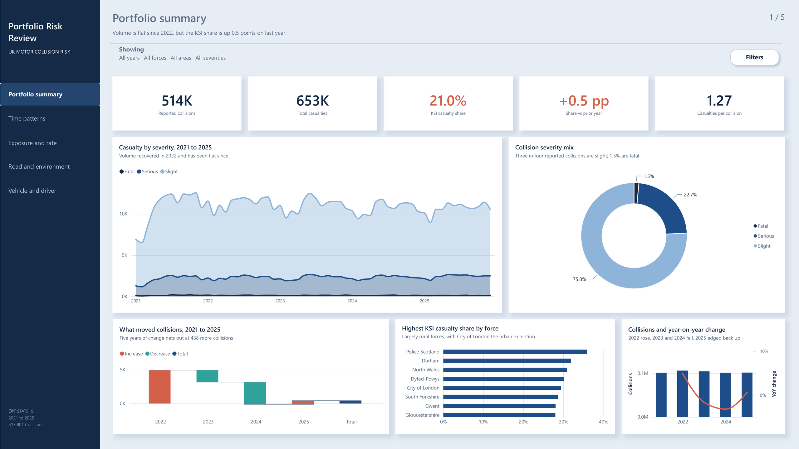

# UK Motor Collision Risk

A five-page Power BI report on UK road collisions, 2021 to 2025, built from the
Department for Transport's STATS19 open data. 513,801 reported collisions,
652,821 casualties, three fact tables and ten dimensions.

It is structured the way an insurer reads a book of business: headline position
first, then exposure against rate, then the factors that move the rate.



---

## Findings

**Rural roads are worse at every posted speed limit.** Not just on faster
roads. At 20, 30, 40, 50, 60 and 70mph alike, the rural KSI casualty share sits
above the urban one. Impact speeds and ambulance response times, not the limit
on the sign.

**Frequency peaks at rush hour. Severity peaks at four in the morning.** Weekday
collisions climb to a twin peak at 8am and again from 3pm to 5pm, highest on
Friday. The KSI casualty share does almost the opposite: lowest at 8am, highest
before dawn. Two different stories living in the same data.

**Severity peaks at 60mph and falls again at 70.** Motorways carry the fastest
traffic and a lower severity share than 60mph roads, because they have no
oncoming traffic, no junctions and no pedestrians.

**Motorcycles are worse than cars at every driver age band**, by a factor of
two to three throughout. Cars dominate casualty volume; motorcycles dominate
severity. Neither fact is visible without the other.

**Five years of effort nets out at 438 more collisions.** 2022 rose by 4,917 as
traffic returned, 2023 fell by 1,746, 2024 fell by 3,331, and 2025 rose by 598.

---

## Pages

| Page | What it answers |
| --- | --- |
| Portfolio summary | Where the book stands and which way it is moving |
| Time patterns | When collisions happen, and when they are worst |
| Exposure and rate | Which segments carry volume, which carry severity |
| Road and environment | What the road and the conditions do to outcomes |
| Vehicle and driver | The rating factors an insurer actually prices on |

Full-size screenshots of all five pages are in [`/screenshots`](screenshots).

### Walkthrough

The filter panel, cross-page filtering and the decomposition tree running live.

https://github.com/user-attachments/assets/636edba8-a9e5-4224-83a9-bfada76c6e8b


---

## The model

Three fact tables and ten dimensions in a star schema, with one bridge.

```
                 Dim_Date   Dim_CollisionSeverity   Dim_RoadType
                 Dim_Light  Dim_Weather             Dim_Surface
                 UrbanRural Dim_PoliceForce         Dim_RoadClass
                            \      |      /
                             Collisions  (513,801)
                                  |
                             Vehicles          <- Dim_VehicleType, Dim_DriverAge
                                  |  VehicleKey
                             Casualty  (652,821) <- Dim_CasualtySeverity, Dim_CasualtyClass
```

Three decisions in that diagram are worth calling out.

**Casualty does not join Collisions directly.** The obvious join on
`collision_index` leaves vehicle and driver dimensions unable to filter
casualties, because the filter cannot travel back up from Vehicles to
Collisions. Instead both Vehicles and Casualty carry a composite
`VehicleKey = collision_index & "-" & vehicle_reference`, and the chain runs
Collisions to Vehicles to Casualty in one direction.

**Severity is two dimensions, not one.** STATS19 records severity on the
collision (how bad was the worst outcome) and separately on each casualty (how
badly was this person hurt). A single shared dimension lets the slicer filter
one field while the measure counts the other, and the two silently disagree.
`Dim_CollisionSeverity` and `Dim_CasualtySeverity` are kept apart.

**The headline measure is named for what it is.** `KSI Casualty Share` is
killed-or-seriously-injured casualties over all casualties. It is a
composition, not a per-exposure rate, and calling it a rate would imply a
denominator this data does not have.

---

## Measures

Twenty-one in all, on a dedicated `Measures` table. The ones that carry the
report:

| Measure | Definition |
| --- | --- |
| `Total Collisions` | `COUNTROWS(Collisions)` |
| `Total Casualties` | `COUNTROWS(Casualty)` |
| `Total Vehicles` | `COUNTROWS(Vehicles)` |
| `KSI Casualties` | `CALCULATE([Total Casualties], Casualty[casualty_severity] IN {1,2})` |
| `KSI Casualty Share` | `DIVIDE([KSI Casualties], [Total Casualties])` |
| `Fatal Casualty Share` | `DIVIDE(CALCULATE([Total Casualties], Dim_CasualtySeverity[SeverityCode]=1), [Total Casualties])` |
| `Casualties per Collision` | `DIVIDE([Total Casualties], [Total Collisions])` |
| `Collisions Involved` | `DISTINCTCOUNT(Vehicles[collision_index])` |
| `Casualties per Collision Involved` | `DIVIDE([Total Casualties], [Collisions Involved])` |
| `Collisions LY` · `Casualties LY` · `KSI Casualty Share LY` | `CALCULATE(<base measure>, SAMEPERIODLASTYEAR(Dim_Date[Date]))` |
| `KSI Share vs LY (pp)` | `([KSI Casualty Share] - [KSI Casualty Share LY]) * 100` |
| `Collisions Change` | `IF(ISBLANK([Collisions LY]), BLANK(), [Total Collisions] - [Collisions LY])` |
| `Collisions Rolling 12M` | `CALCULATE([Total Collisions], DATESINPERIOD(Dim_Date[Date], MAX(Dim_Date[Date]), -12, MONTH))` |
| `KSI Share (reliable)` | `IF([Total Casualties] >= 500, [KSI Casualty Share])` |

---

## Data quality

**Low-sample suppression.** Any ranked visual carries a minimum of 500
casualties, and the driver-age-by-vehicle-type matrix greys out cells below
that threshold rather than hiding them. Without it, a van driven by an
11-to-15-year-old shows a 77.8% KSI share on nine casualties and outranks every
real finding on the grid.

**The bridge was audited.** `Unmatched Casualties` returns 0 against 652,821,
so every casualty resolves to a vehicle and nothing drops silently out of a
vehicle-filtered visual. There is a hidden `Checks` page in the file carrying
that test.

**Known limits of the source.** STATS19 covers police-reported personal-injury
collisions only; damage-only collisions are absent. There is no exposure
denominator in the model, so every rate here is a share of casualties rather
than collisions per vehicle mile. Injury-based severity reporting was adopted
by police forces at different dates, so cross-year severity comparison is
indicative rather than exact.

---

## Contents

```
README.md
screenshots/                      one PNG per page
demo.mp4                          walkthrough of the live report
theme/portfolio-risk-review.json  the Power BI theme
```

The `.pbix` carries all three fact tables embedded, which puts it at 66 MB, so
it lives in [Releases](../../releases/latest) rather than in the tree. Download
it there and open it in Power BI Desktop (free) to inspect the model,
relationships and DAX directly.

---

## Source

Department for Transport, Road Safety Data (STATS19), collision, vehicle and
casualty tables for the last five years, plus the Road Safety Open Dataset Data
Guide used to build every lookup dimension.
<https://www.data.gov.uk/dataset/cb7ae6f0-4be6-4935-9277-47e5ce24a11f/road-safety-data>

Open Government Licence v3.0.
